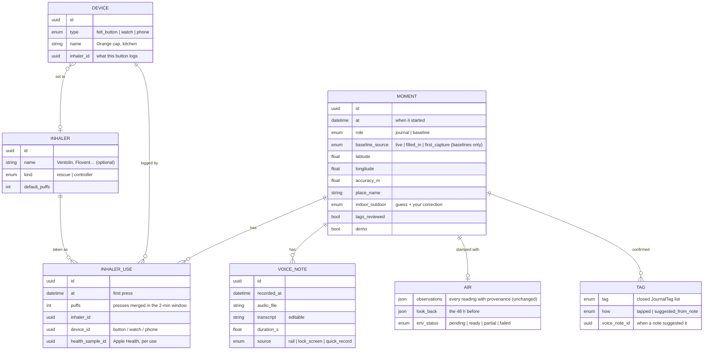

# The data model (Oct 17, 2026)

"Object model", "data model" or "domain model" all fit: the things felt air keeps, and how they relate. Today one
SwiftData object, `LogEvent`, holds everything. That served the first build; the questions below (several voice notes,
puffs, which inhaler, which device) say it's time to split it.

**Built (phase 1):** `LogEvent` is the moment and gains `uses: [InhalerUse]` and `notes: [VoiceNote]`; inhalers are
named in onboarding and renamed in Settings › Devices; presses within 2 minutes add puffs; Apple Health gets one Inhaler
Usage sample per use, valued in puffs (Apple's type is a cumulative count of puffs); baselines are hidden from the
journal. A one-time additive upgrade (`ModelUpgrade`) gave existing moments their uses and notes. The fuller split below
(a separate `Moment`, `Device` entity, derived kind) can follow when it pays for itself.

## The questions, answered

| Question | Answer |
|---|---|
| Several voice notes on one moment? | **Yes.** A moment has many `VoiceNote`s (each its own audio, words, time). Today it's one file and appended text. |
| Inhaler uses with puffs? | **Yes.** A moment has many `InhalerUse`s, each with **puffs**. Presses within the **2-minute Event Window** (owner decision, PR #51) merge into one use with more puffs. |
| Where does rescue / maintenance belong? | **On the inhaler (the medicine), not the moment.** A use points at an `Inhaler` (rescue or controller). The moment's kind is *derived*: any rescue use → a rescue moment. |
| Device id? | **On the use**, as "how it was logged": a felt button (its id), the watch, the phone. A `Device` can also be set to an inhaler (the orange cap is your blue Ventolin). |

## The model

**What a moment *is*, derived (never stored twice):**

| Has | Shows as |
|---|---|
| a rescue use | **Rescue** (counts in patterns) |
| only controller uses | **Standard** (never in patterns) |
| no uses, a voice note or tags | **Note** (never in patterns) |
| role = baseline | **Baseline** (the comparison) |

So "Rescue" stops being a field you set and becomes a fact about the uses.

## What it changes

- **Patterns:** unchanged maths. A frame is still a moment; it's an inhaler moment when it has a rescue use. Puffs
  don't change patterns yet; they could later weight a moment (2 puffs vs 6), never shown as numbers.
- **The felt button:** a press finds or opens the moment within the 2-minute window and adds a puff to its use.
  Which inhaler comes from the button's setting (Settings › Devices), not only its cap colour.
- **Apple Health:** one Inhaler Usage sample per use, with the puff count as its value (today: one per press).
- **Voice:** each recording is its own note. The rail's review saves a note, and Your voice lists them, newest first.
- **Export:** moments.csv keeps one row per moment, plus `inhaler_uses.csv` and `voice_notes.csv`, joined by moment id.
- **Baselines** become `role = baseline` moments with no uses or notes. They don't mix with the journal in lists.
- **Watch:** a press is a use with `device = watch`.

## Migration (when we build it)

SwiftData `VersionedSchema` and a migration plan, on the phone, in one pass:

1. Every `LogEvent` becomes a `Moment` with the same id, time, place, air, tags and review flag.
2. Rescue and Standard events get one `InhalerUse` (puffs 1, a default Rescue or Controller inhaler, device unknown,
   the existing Health sample id).
3. A voice file and transcript become one `VoiceNote`.
4. Baseline events become `role = baseline` (filled-in ones keep `filled_in`).

Before migrating real data: **Settings › Data sets › Save current as…** (it's a file; it survives anything).
Data set files need the same upgrade, so they read both shapes.

## Decisions (owner, Oct 17)

- **Puffs** come from presses within the 2-minute window (any device: felt button, watch, the phone's +). Undo takes
  one puff off.
- **Inhalers** are named in onboarding and renamed in Settings › Devices.
- **A note during a rescue** goes into that moment (on Now: a rescue or Standard in the last 30 minutes), otherwise it
  becomes a Note.
- **Baselines** stay in the backend: filled in, used by the maths, in the export, never on the timeline or in the
  moments list. Only the idea shows, in the verdict ("Looks like your baseline days").
- **Apple Health** gets one sample per use, valued in puffs.
- **Your own profile vs demos:** your data is a saved data set; the archetypes are made-up people you swap in
  (Settings › Data sets). Saved sets keep uses and notes.
